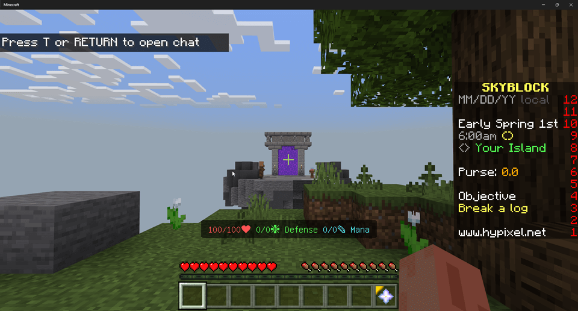

# SkyBlock
Skyblock is one of the most popular survival gamemodes. The idea is that you can create and expand your very own world infinitely with only minimal materials.

## Installation
1. Download the [.mctemplate file](https://github.com/kirbycope/SkyBlock-Bedrock/raw/main/SkyBlock-Bedrock.mctemplate)
1. Double-click the mctemplate file
1. Create a New World using the template
    - "Play" > "Create New"  > Scroll down to "Imported Templates" (Select "See More" if necessary)

## Releasing
Pushing a tag that starts with `v` (for example `git tag v1.0.0 && git push origin v1.0.0`) runs the Release workflow in `.github/workflows/release.yml`, which builds the world template and attaches `SkyBlock-Bedrock.mctemplate` to a GitHub Release.

To build it locally, run `python tools/build_addon.py`. It writes `build/SkyBlock-Bedrock.mctemplate`, which git ignores, and leaves the committed `SkyBlock-Bedrock.mctemplate` as it is.
